# QUY TRÌNH UPLOAD & LƯU HÌNH ẢNH CHO TÀI KHOẢN (SKILL)
> **Hệ thống Quản lý & Học trực tuyến LMS Đào tạo Lái xe**  
> *Chuẩn hóa kiến trúc: Node.js / NestJS • TypeScript • Multer • TypeORM / SQL Server • React / Vite*

---

## 1. TRIẾT LÝ THIẾT KẾ CỐT LÕI

> **"Ổ đĩa giữ ảnh – Database giữ đường dẫn (URL)"**

### Tại sao KHÔNG lưu dữ liệu nhị phân (Binary / BLOB / VARBINARY) trực tiếp vào SQL Server?
1. **Bảo toàn hiệu năng CSDL:** Dữ liệu nhị phân của ảnh làm phình to tệp dữ liệu CSDL (`.mdf`, `.ldf`), làm nghẽn bộ nhớ đệm Buffer Pool của SQL Server và làm chậm nghiêm trọng các truy vấn Index/SELECT.
2. **Tối ưu hóa Backup & Restore:** Tách biệt dữ liệu quan hệ và tệp tĩnh giúp việc sao lưu dữ liệu diễn ra trong vài giây thay vì hàng giờ.
3. **Tận dụng HTTP Static Caching & CDN:** Trình duyệt và mạng phân phối nội dung (CDN/Nginx) có thể cache ảnh tĩnh hiệu quả với mã phản hồi `304 Not Modified`, giải phóng 90% tải cho Database Server.

---

## 2. KIẾN TRÚC TỔNG QUAN (END-TO-END PIPELINE)

```mermaid
sequenceDiagram
    autonumber
    actor User as Người dùng (Admin / GV / Học viên)
    participant UI as Giao diện React (Vite + Axios)
    participant Auth as Guard Xác thực (JwtAuthGuard)
    participant Multer as Middleware File (Multer)
    participant Disk as Ổ đĩa máy chủ (/uploads/avatars/)
    participant DB as CSDL (SQL Server)

    User->>UI: Chọn ảnh từ máy tính (<input type="file">)
    UI->>UI: Đóng gói FormData (append "avatar", file)
    UI->>Auth: Gửi POST /api/v1/users/me/avatar (multipart/form-data + Bearer JWT)
    
    critical 1. Xác thực danh tính trước
        Auth->>Auth: Xác minh JWT Token hợp lệ
        alt Token sai hoặc hết hạn
            Auth-->>UI: 401 Unauthorized
        end
    end

    Auth->>Multer: Chuyển tiếp Request đã xác minh
    critical 2. Bộ lọc 4 lớp an toàn
        Multer->>Multer: Kiểm tra dung lượng (<= 2MB)
        Multer->>Multer: Kiểm tra định dạng (JPEG / PNG / WEBP)
        Multer->>Multer: Đổi tên file ngẫu nhiên an toàn (UUID/Timestamp)
        Multer->>Disk: Ghi file vật lý xuống thư mục đích
    end

    Multer->>DB: UPDATE dbo.NguoiDung SET AvatarUrl = '/uploads/avatars/...' WHERE MaNguoiDung = userId (từ JWT)
    DB-->>UI: HTTP 200 OK (Trả về JSON kèm AvatarUrl mới)
    UI->>User: Cập nhật Avatar trên Header và Profile ngay lập tức
```



---

## 3. NĂM BƯỚC THỰC HIỆN CHI TIẾT

### BƯỚC 1: Frontend – Đóng gói dữ liệu bằng `FormData`
- **Giao thức:** Sử dụng `multipart/form-data` thay cho `application/json` thông thường.
- **Quy chuẩn mã nguồn React:**
  ```typescript
  // 1. Tạo đối tượng FormData
  const formData = new FormData();
  formData.append('avatar', selectedFile); // Tên field 'avatar' PHẢI TRÙNG với cấu hình Multer ở Backend

  // 2. Gửi request qua Axios kèm Bearer JWT Token
  const response = await axios.post('/api/v1/users/me/avatar', formData, {
    headers: {
      Authorization: `Bearer ${token}`,
      // LƯU Ý: Để trình duyệt tự động gán 'Content-Type' kèm 'boundary', không tự gán cứng!
    },
  });
  ```

---

### BƯỚC 2: Backend Pipeline – Nguyên tắc "Xác thực đứng trước Multer"
- **Thứ tự Middleware:**
  ```text
  Client Request ➔ JwtAuthGuard (isAuth) ➔ Multer (File Upload) ➔ Controller / Service
  ```
- **Quy tắc an toàn sống còn:**
  - **KHÔNG BAO GIỜ** đặt Multer chạy trước `isAuth`. Nếu đặt Multer trước, kẻ xấu có thể gửi hàng nghìn file rác làm tràn dung lượng ổ đĩa máy chủ mà không cần đăng nhập.
  - **KHÔNG TIN `userId` TỪ BODY:** Phải trích xuất danh tính từ payload của JWT Token đã giải mã (`@CurrentUser('userId')`). Tránh lỗi bảo mật học viên A upload ảnh đè lên tài khoản của học viên B.

---

### BƯỚC 3: Bộ lọc 4 lớp an toàn của Multer
Cấu hình Multer bắt buộc phải thực thi đủ 4 lớp kiểm tra:
1. **Giới hạn dung lượng (`limits.fileSize`):**
   - Tối đa **2MB** (`2 * 1024 * 1024 = 2,097,152 bytes`).
   - Bắt lỗi chuẩn: Bắt mã lỗi `LIMIT_FILE_SIZE` và trả về `400 Bad Request`.
2. **Kiểm tra định dạng (`fileFilter`):**
   - Chỉ cho phép các định dạng ảnh: `image/jpeg`, `image/png`, `image/webp`.
3. **Kiểm tra nội dung thực tế (Magic Bytes):**
   - Không chỉ dựa vào phần mở rộng đuôi file (`.png`), mà kiểm tra signature byte đầu tệp để chặn các mã độc (PHP/Shell/Script ngụy trang đuôi ảnh).
4. **Chuẩn hóa tên file & Chống tấn công Path Traversal:**
   - Thay thế toàn bộ tên file gốc của người dùng bằng định danh duy nhất:
     ```typescript
     filename: (req, file, cb) => {
       const uniqueSuffix = Date.now() + '-' + Math.round(Math.random() * 1e9);
       const ext = path.extname(file.originalname).toLowerCase();
       cb(null, `avatar-${uniqueSuffix}${ext}`);
     }
     ```

---

### BƯỚC 4: Lưu trữ & Cập nhật CSDL SQL Server
1. **Lưu trữ vật lý:**
   - File được ghi vào thư mục máy chủ: `./uploads/avatars/avatar-1730000000.png`.
2. **Lưu đường dẫn vào CSDL:**
   - Đường dẫn lưu trong cột `AvatarUrl` của bảng `dbo.NguoiDung`: `/uploads/avatars/avatar-1730000000.png`.
   - Câu lệnh SQL chuẩn:
     ```sql
     UPDATE dbo.NguoiDung
     SET AvatarUrl = @avatarUrl, NgayCapNhat = GETDATE()
     WHERE MaNguoiDung = @userId AND DaXoa = 0;
     ```
3. **Cơ chế Dọn dẹp rác (Garbage Collection):**
   - Trước khi cập nhật đường dẫn mới, kiểm tra và dùng `fs.unlink()` xóa file ảnh cũ của người dùng trên đĩa để tránh lãng phí dung lượng lưu trữ.
4. **Cơ chế Hoàn tác lỗi (Rollback on Error):**
   - Nếu câu lệnh CSDL thất bại (ví dụ: mất kết nối SQL Server), khối `catch` phải tự động xóa file vật lý vừa lưu trong thư mục `uploads/` để đảm bảo tính nhất quán dữ liệu.

---

### BƯỚC 5: Phục vụ File tĩnh & Hiển thị trên Frontend
1. **Cấu hình Static Assets trên Backend:**
   - Cung cấp quyền đọc công khai cho thư mục `/uploads`:
     ```typescript
     // NestJS (main.ts):
     app.useStaticAssets(join(__dirname, '..', 'uploads'), {
       prefix: '/uploads/',
     });
     ```
2. **Cấu hình CORS an toàn:**
   - Chỉ cho phép Origin của giao diện (ví dụ `http://localhost:5173`) truy cập tài nguyên.
3. **Phản hồi chuẩn từ API:**
   ```json
   {
     "success": true,
     "message": "Cập nhật ảnh đại diện thành công.",
     "data": {
       "avatarUrl": "/uploads/avatars/avatar-1730000000.png"
     }
   }
   ```
4. **Hiển thị trên giao diện React:**
   - Giao diện nhận `avatarUrl` và cập nhật trực tiếp vào State/Context:
     ```tsx
     
     ```

---

## 4. BẢNG CHECKLIST AN TOÀN CHO DEVELOPER

Trước khi đưa tính năng upload ảnh tài khoản lên môi trường kiểm thử/production, lập trình viên cần tự kiểm tra 7 điểm sau:

- [ ] **1. Xác thực:** Route upload có `isAuth` / `JwtAuthGuard` bảo vệ không?
- [ ] **2. Thứ tự:** `isAuth` có được đặt TRƯỚC middleware Multer không?
- [ ] **3. Danh tính:** `userId` được lấy từ Token hay từ `req.body`? (Bắt buộc lấy từ Token).
- [ ] **4. Giới hạn dung lượng:** Đã cấu hình chặn file vượt quá 2MB chưa?
- [ ] **5. Giới hạn định dạng:** Đã chặn các file không phải ảnh (file `.exe`, `.php`, `.js`, `.sh`) chưa?
- [ ] **6. Đổi tên file:** Tên file có được sinh ngẫu nhiên bằng timestamp/UUID không?
- [ ] **7. Dọn dẹp rác:** Đã có logic xóa ảnh cũ khi đổi ảnh mới và rollback xóa file khi lỗi CSDL chưa?
